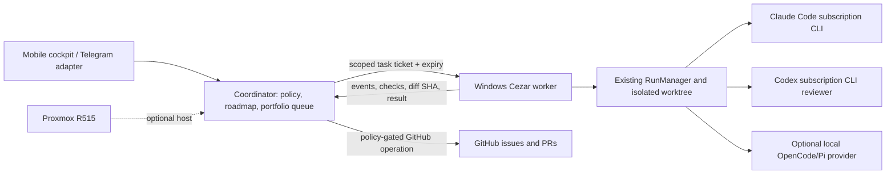

# Cezar architecture audit: autonomous multi-project development management

**Audit date:** 2026-10-22  
**Scope:** source, tests, project documentation, current provider documentation  
**Status:** investigation and recommendations only; no application code or external state changed.

## Executive assessment

Cezar is a capable single-machine coding-agent cockpit with real multi-project support, isolated task worktrees, persistent run history, resumable backend sessions, workspace-wide concurrency/resource controls, scheduled/event-driven automations, and a dashboard suitable for remote viewing behind an authenticated proxy. These are strong foundations for autonomous work.

It is not yet a development-management system that can safely prioritize a portfolio, operate against approved roadmaps, track GitHub issues end to end, verify implementation, and merge within policy. The main gap is not another agent runner. It is a durable policy and orchestration layer that owns work selection, approval scope, model capacity, verification evidence, and merge authorization across projects. Current automation launches an ordinary task from a configured trigger; successful work generally ends as a local result or draft PR/review state. There is no global portfolio queue, and GitHub merge is an explicit cockpit action.

Recommended direction: keep Cezar as the local execution plane and extend its existing workspace scheduler, automation, run store, Forge, and contract seams. Put a separate, small coordinator on the Dell only if it owns durable portfolio policy and sends authenticated, narrow task orders to the Windows worker. Avoid moving agent credentials or repositories to the R515 as a first step. Use Windows for the first worker validation, then compare WSL2 for filesystem/process reliability before deciding whether it becomes the worker host.

## 1. Existing architecture

### Runtime and deployment model

- Four npm workspaces: `packages/cezar` (Node service and CLI), `packages/contract` (Zod API contracts), `packages/api-client` (typed browser/server client and event protocol), and `packages/web` (React/Vite cockpit). The root scripts span workspaces. See the root and workspace `package.json` files and `AGENTS.md` repository map.
- The service is a single Node process using Hono, SSE/WebSocket for live state, JSON/NDJSON and Markdown files for persistence, and YAML-defined workflows. The browser is served as static output built from `packages/web` into `packages/cezar/web/dist`.
- Default local server binding is `127.0.0.1` (`packages/cezar/src/server/server.ts`, `startServer`). A request-origin guard rejects untrusted Host/origin requests in local mode (`server.ts`, `isLoopbackHostHeader` in `server/capabilities.ts`). Remote hosting is designed around an authenticated reverse proxy that leaves the app loopback-bound; current documented installers target Ubuntu/Debian + nginx/systemd and macOS + ngrok/launchd (`docs/server-install/`). There is no documented Windows service installer.
- Project registry and shared resource settings live under `CEZ_HOME` (default `~/.cezar`) through `workspace/config.ts`, `workspace/projects.ts`, and `workspace/semaphore.ts`. Per-project run state is in each checkout’s `.ai/cezar/`. Project contexts are created lazily in `server/project-context.ts`.

### Task lifecycle and backend seam

- `workflows/run.ts` is the large central orchestrator: it creates/runs workflow steps, acquires worktrees/leases, streams events, manages queues, waits, retries/continuations, auto-resume, checks, and task settlement. `runs/store.ts` validates records, persists `runs.json` and append-only per-run NDJSON, and reconstructs index state. The store is restart-aware, but recovery semantics are deliberately not equivalent to a transparent process checkpoint: interrupted live runs are reconciled as failed and can be continued/recovered using persisted backend session IDs and handoff context.
- `core/agent-runner.ts` defines the normalized runner/session protocol. `core/runner-factory.ts` selects the implementation. Available runners include Claude Code, Codex app-server, OpenCode, Cursor, Pi, Junie, and Copilot. Claude uses a persistent CLI process/stream protocol; Codex uses its app-server JSON-RPC protocol. Session IDs are captured for resume. `AGENT_PROTOCOL.md` is the compatibility contract.
- Project agent profiles/accounts support separate vendor homes where documented (`core/agent-profiles.ts`, `workspace/agent-profiles.ts`, `workspace/agent-accounts.ts`). Claude’s `CLAUDE_CONFIG_DIR` and Codex’s `CODEX_HOME` allow distinct local logins; this is useful for account separation, not a shared quota API.
- Permissions are not a strong isolation boundary by default. `AgentRunSpec` documents that Claude’s default allowed-tools include unrestricted Bash, while Codex/OpenCode/Cursor do not honor the same allowlist. `.ai/specs/2026-07-17-permission-modes.md` and `AGENTS.md` describe these differences. A worktree isolates Git changes, not process access, credentials, network, or host filesystem.

### Automation, dispatch, and resource management

- `automations/` supports GitHub event polling, Jira/Linear tracker polling, and time schedules. `automations/scheduler.ts` is a process-local timer over registered projects; `schedule-runner.ts`, `github-poller.ts`, and `tracker-poller.ts` evaluate bounded inputs and use receipts/leases to avoid duplicate delivery. Definitions are per-project and enabled explicitly. A matching event launches an ordinary run (`task-template.ts`); automation documentation explicitly says it does not guarantee a PR or tracker update (`docs/issue-trackers.md`).
- `dispatch/engine.ts` and `cez task` let an agent spawn child runs, track reports, cap child concurrency, and reserve USD budgets when configured. Dispatch is a task tree inside one project/task context, not cross-repository prioritization. Budget is dollar-based and cannot directly express subscription quota reservations.
- `workspace/semaphore.ts` enforces a shared `maxParallel` cap and optional memory ceiling across projects. `workflows/run.ts` performs queue pumping and account-level holds around known provider usage limits. This is valuable infrastructure, but it does not score or rank queued work by portfolio priority, deadline, roadmap dependency, or available fallback model.
- `core/host-usage.ts` reports machine CPU/memory/swap and container limits. It is telemetry, not a GPU-aware model selector or provider capacity meter. `core/process-usage.ts`/dashboard cost views report task-level usage where backends provide it.

### GitHub and remote cockpit

- `server/forge/github.ts` is the provider seam for GitHub item/PR browsing, checks, comments, diffs, statuses, draft PR creation, and an explicit PR merge operation. `server/pr.ts` and `server/github.ts` are delegates. The GitHub cockpit is a management UI, not an issue queue backed by autonomous lifecycle policy.
- No issue-create route or `gh issue create` path was found in the service. Existing issue support includes browse/search/detail and some comment/status interactions; issue creation/tracking through an autonomous lifecycle must be added deliberately.
- The mobile dashboard is the responsive web cockpit; the same remote hosting model applies. No Telegram bot, Telegram protocol, or Telegram integration was found in source/docs.
- Hosted mode hides local handoff features. Terminal exposure is explicitly sensitive: `CEZ_TERMINAL=1` in hosted mode means users admitted by the reverse proxy can obtain a task shell (`.env.example`). Cezar itself does not provide user accounts/roles; authentication is delegated to the front proxy.

## 2. Feature compatibility matrix

| Requirement | Current support | Audit judgment |
| --- | --- | --- |
| Autonomous execution of approved roadmap items | Scheduled and GitHub/Jira/Linear event automations can launch autonomous runs; workflows are selectable and runs can dispatch bounded child tasks. | Partial. No roadmap parser, approval ledger, roadmap-item state machine, dependency resolver, or policy check that binds an agent’s task to an approved scope. |
| Intelligent prioritization across repositories | Multi-project registry; workspace concurrency/memory caps; runs index aggregates projects. | Missing. Queues are principally per-manager/arrival-time; no portfolio scoring, aging/fairness, deadlines, dependency graph, or cross-project “next best task” decision. |
| GitHub issue create, track, fix, verify, merge | GitHub polling/browsing, PR/check/comment/status functionality; `gh` can create draft PRs and the Forge has a user-triggered merge action. | Partial. No unified issue lifecycle or issue-create capability found. No policy-gated automatic merge pipeline that consumes immutable verification evidence. Current PR merge is human initiated. |
| Claude usage management (short windows, weekly, reset, reserve) | Usage/cost display, provider usage-limit classification, known reset deadline capture, account profiles, automatic resume. | Partial. No first-party quota ledger with short-window and weekly counters or reservation allocation. Cezar cannot know the user’s remaining subscription capacity reliably from token/cost totals alone. |
| Pause/resume as model capacity changes | Usage-limit errors can park failed runs and persist `autoResumeAt`; scheduled auto-resume survives restart; retry caps prevent loops. | Partial. Covers detected Claude usage-limit reset, not proactive capacity shaping, shared cross-client use, weekly limits, alternative-model failover, or Codex capacity state. |
| Intelligent Claude/Codex/local routing | Selectable runner/model per workflow/step; runner profiles/accounts; OpenCode/Pi accept provider/model identities. | Partial. Routing is configuration/selection, not an adaptive policy. No first-class Ollama/local-health, GPU memory, quality/cost routing, or fallback arbitration was found. OpenCode/Pi may be configurable for local providers, but that is not verified as a tested Cezar-managed local-model capability. |
| Telegram and mobile remote control | Responsive web cockpit can be remote-hosted behind an authenticated proxy. | Mobile web: supported. Telegram: absent. A bot would need a separate narrow command surface, identity binding, replay protection, and explicit high-impact action gates. |
| Interrupt urgent work | Run cancellation, session interrupt, messages to waiting/running sessions, queued messages, and high-level run controls exist. | Partial. Human interruption is supported in the cockpit/API. No priority preemption policy that safely checkpoints a lower-priority task and releases capacity for an urgent run. |
| Hours/days unattended | Automations, worktree autosave, persistent logs, timers, queue limits, retry/lease mechanisms, draft/review lifecycle. | Partial. One-process timers and CLI children can run unattended, but durable coordinator ownership, operational alerting, watchdog service, and robust provider-capacity budgeting are incomplete. |
| Crash/reboot/rate-limit recovery | Run records and event logs persist; startup recovery reconciles interrupted runs; Claude/Codex session identifiers support continuation; auto-resume deadlines persist. | Partial. Recovery is restart-and-continue, not transparent process restoration. There are multiple crash points around file writes, child creation, and external GitHub side effects that need idempotency checks before autonomous retries. |
| Coordinator/worker security separation | Process environment sanitization helpers, private tracker credentials, worktree isolation, local-only default bind, origin guard, hosted capability gating. | Partial. No separate coordinator/worker protocol or OS sandbox. Agent runs can inherit significant authority; project credentials and `gh` auth may be available to processes on the worker. |
| Windows and WSL2 | Windows-aware code/tests exist for server, shells, process trees and native agent launching. Anthropic documents Windows with Git Bash or WSL; Codex has Windows support with WSL option. | Plausible on Windows, but unattended service reliability should be validated. WSL2 is a reasonable comparison target, especially for Linux-native agent flows; repo placement, path translation, process recovery, credential access, and file watcher behavior must be measured. |
| Minimal upstream divergence | Cezar already exposes clean extension seams in runner, Forge, project contexts, automation, Zod contract, and workspace service. | Achievable if orchestration policy is a separable package/module and upstream-compatible contracts are preserved. Avoid a fork or replacement of `RunManager`. |

## 3. Missing functionality and technical challenges

### Approved-roadmap execution and portfolio prioritization

Introduce an explicit approved-work record separate from freeform prompts. It should carry repository/project ID, roadmap item ID and revision, allowed paths/actions, acceptance criteria, risk class, verification plan, merge policy, expiration/revocation, and the approving principal. A policy service should evaluate every dispatch and external side effect against this record. The existing automation `enabled` switch means “launch on this trigger”; it is not an approval of an arbitrary roadmap’s entire contents.

Add a workspace-level task broker above existing project `RunManager`s. It can initially rank a bounded set of approved candidates using deterministic signals (priority, deadline, dependency readiness, age, project caps, provider availability) rather than an LLM deciding its own authority. Persist the decision inputs and chosen order for auditability. Keep existing local queues as the execution mechanism; add broker-issued launch tickets and fair scheduling rather than rewriting run lifecycle.

### GitHub lifecycle and safe merging

The current Forge merge action is an interactive capability. A future auto-merge path should require all of: approved issue/roadmap scope; fixed target repository/branch; current PR head SHA; all required checks green; reviewer verdict from a distinct reviewer; diff policy checks; no unresolved review threads; and an explicit merge policy for that project. Bind verification to the exact SHA to prevent time-of-check/time-of-use drift. Keep human approval as default; auto-merge must be opt-in per project and bounded to approved labels/issue IDs or roadmap entries.

Issue creation should be a separate action with idempotency keys, dedupe, labels/assignees allowlists, and an audit event. Issue transitions and PR updates need provider capabilities represented through the existing Forge/tracker abstractions instead of embedding `gh` commands into prompts.

### Model capacity and routing

Model selection must distinguish observable facts from estimates. Cezar can capture CLI error/reset messages and its own task token/cost reports. It cannot infer remaining shared Claude subscription capacity when the same account is used in Claude’s app, other terminals, or another Cezar process. Provider limits vary with context, model, attachments and concurrent sessions; reset information may only be exposed on a particular error. Treat the provider CLI as the authoritative gate; add conservative local reservations and a pause state, not a claimed exact remaining quota.

Implement a capacity adapter per runner/account with states such as available, constrained-until, unavailable, unknown; source/provenance; short-window and weekly reset if explicitly reported; and estimated cost/token reservations. Unknown must remain unknown. Route only when a fallback is explicitly configured and supports the task’s requirements. Codex subscription availability is usable through its supported signed-in CLI, but usage limits are plan dependent and are not established by Cezar’s CLI protocol as a queryable budget. API-key billing must not be silently substituted for a subscription.

Claude’s `/status` and CLI warnings are useful observables; parsing a user-facing status screen should be a last resort and version-tested. Prefer supported CLI error/event output and account documentation. Do not automate account switching to evade limits. Provide operator-facing thresholds and capacity reservations that intentionally leave headroom for urgent work.

### Local-model capability

The RTX 3060 12 GB can host useful quantized coding models, but model size/context/concurrency determine feasibility. The Cezar codebase has multi-provider runner support (notably OpenCode and Pi) but no first-class local inference service lifecycle, health checks, VRAM detection, or GPU-aware routing. Treat local LLM as optional low-risk work (triage, summaries, tests, simple fixes) until quality is measured on the target repositories. Do not add an Ollama dependency to Cezar’s default path; discover a configured local OpenAI-compatible endpoint or disable the option quietly.

### Telegram and urgent intervention

Build Telegram as a remote-control adapter to existing APIs, not a second task engine. Start with read-only status and notifications; bind Telegram user/chat IDs to an explicit allowlist; require confirmations for cancel, credentials, issue writes, PR publish, and merge; use one-time, expiring action tokens for consequential buttons; and record every action with the external identity. The responsive cockpit remains the richest interface. Urgent tasks need a scheduler interruption policy with graceful cancellation, checkpoint/handoff, lease release, and an explicit resume queue so preemption does not corrupt an in-progress worktree.

## 4. Subscription and platform verification

### Claude Code

**Verified from official Anthropic documentation:** Claude Code supports authentication with a Claude Pro/Max account as well as Anthropic Console API billing; it supports Windows 10+ via WSL or Git for Windows/Git Bash. Claude Pro/Max usage is shared between the Claude app and Claude Code. Anthropic describes five-hour limits and weekly limits; documented prompt-count examples are averages, not guaranteed capacity. On a usage limit, the documented choices include waiting for reset or switching to separately billed API usage. See [Claude Code setup](https://docs.anthropic.com/en/docs/claude-code/getting-started), [Claude Code CLI reference](https://docs.anthropic.com/en/docs/claude-code/cli-usage), and [Using Claude Code with Pro or Max](https://support.anthropic.com/en/articles/11145838-using-claude-code-with-your-pro-or-max-plan).

**Repository behavior:** Cezar launches the installed `claude` CLI using its existing auth/config home and supports resume by session ID. It does not require an Anthropic API key for this CLI route. The audit did not find Cezar code that reads Anthropic’s subscription quota account dashboard; usage gating is based on CLI-run errors and available reset information (`workflows/run.ts`, usage-limit auto-resume helpers; `runs/store.ts`, `autoResumeAt`).

### Codex

**Verified from official OpenAI documentation:** Codex is included with ChatGPT plans, with plan-dependent usage limits; Codex CLI supports signing in with a ChatGPT account. Codex works on Windows, and users can select WSL distributions where supported. See [Using Codex with your ChatGPT plan](https://help.openai.com/en/articles/11369540-using-codex-with-your-chatgpt-plan) and [Codex CLI](https://developers.openai.com/codex/cli/).

**Repository behavior:** Cezar runs the `codex app-server` through its supported CLI runner and uses the local Codex identity (default `CODEX_HOME` or a selected profile). This is the supported existing-account path; do not substitute raw API calls if the intent is to use the ChatGPT subscription. A signed-in Codex CLI can still be blocked by its plan limits. Cezar currently lacks a cross-task Codex subscription-capacity manager.

**Constraint:** Provider limits and subscription terms change. The official documents establish CLI sign-in and plan availability, not an authorization for third-party software to bypass limits, and not a stable public quota-query contract. Recheck provider documentation and terms when implementation begins. This audit does not attempt to reverse-engineer credential stores or undocumented APIs.

## 5. Security and reliability findings

### High-priority design risks for the proposed system

1. **Agent authority exceeds worktree scope.** Git worktrees protect checkout state, not the host. Unrestricted Bash, network access, inherited credentials, and backend-specific permission gaps are documented in `core/agent-runner.ts` and the permission-mode spec. A coordinator must not give an agent blanket authority to merge or create arbitrary issues merely because it was assigned one approved item.
2. **Remote cockpit identity is proxy-owned.** Cezar binds to loopback and has strong Host/origin checks, but does not provide user identity/roles. The remote installer relies on Basic Auth at nginx/ngrok. `CEZ_TERMINAL=1` can expose shell access to any identity accepted by that proxy. Do not put the R515 on a public interface without authenticated VPN/proxy controls and narrowly scoped access.
3. **Local service is a privileged control plane.** A process with cockpit API access can start/interrupt tasks, inspect diffs, and use local tools. Keep coordinator-to-worker authentication distinct from browser launch keys; use short-lived, scoped credentials, replay protection, and project-level authorization.
4. **External side effects need idempotency.** Run persistence and automation receipts are a strong foundation, but process crashes can occur after GitHub accepts an issue/comment/PR/merge action and before Cezar records its result. Any automatic retry must query/reconcile the provider state using a stable operation key and PR SHA.
5. **Status is not a checkpoint.** Durable NDJSON and worktree autosave preserve evidence and files, while process/session recovery depends on backend-specific resume support. Model this as “recoverable continuation” with explicit interrupted state, not as exactly-once execution or transparent restoration.

### Existing protective controls

- Loopback binding, HTTP origin/Host guard and WebSocket origin checks (`server/server.ts`, `server/capabilities.ts`).
- Project-scoped contexts and routes; typed Zod request/response contracts (`server/project-context.ts`, `packages/contract`, route parity tests).
- Git worktree isolation, repo leases, workspace semaphore, task cancellation and process termination watchdogs (`git-worktree.ts`, `workflows/run.ts`, `workspace/semaphore.ts`, runner implementations).
- Secret handling and credential separation for tracker connections (`docs/issue-trackers.md`, `server/tracker/connection-env.ts`); secrets are not meant to enter `process.env` globally.
- Opt-in telemetry; hosted mode gates local host-handoff capability.

### Reliability limits to validate

- The automation scheduler is in-process and timer-driven. Durable schedules/receipts survive process restarts, but timer ownership and execution supervision live with the Cezar process. A supervisor must restart it and surface repeated crash loops.
- Workspace state is file-backed, which suits a single host but is not a distributed queue. Multiple Cezar instances sharing a checkout/state path must be treated as an unsupported coordination topology until every lock/lease and atomic write path is proven cross-process safe on Windows and network filesystems.
- Long work depends on vendor CLI stability, authentication refresh, network availability, GitHub rate limits, and Windows child-process semantics. Test process-tree cleanup and path/quoting behavior under real Windows and WSL, not only mocks.
- Avoid placing active Git worktrees on an SMB/NFS share or syncing the same live checkout between Windows and WSL. Git locks, file watchers, and rename semantics can undermine recovery.

No exploitable security vulnerability was established by this architecture audit. The findings above are risks and architectural constraints for the proposed autonomy expansion, not claims of a current vulnerability.

## 6. Recommended architecture

Use a two-plane design with the Windows PC as the first worker host:

- Keep current Cezar as the execution plane: it owns repository checkout, agent process, workflow, normalized events, worktree, checks, and run artifacts.
- Add a coordinator service for approved roadmaps, cross-project ranking, capacity reservations, action policy, notifications, and recovery reconciliation. First implementation may live in the Cezar process with a clean internal interface and durable store; split it onto the R515 only after an API boundary is useful. This minimizes divergence and avoids premature distributed systems work.
- If separated, coordinator sends an immutable task ticket with project/revision/scope/criteria, approved runner choices, budget, expiry, and permitted external operations. Worker returns events plus structured status, commit and tested SHA, check results, and side-effect receipts. Use mutual authentication on a private network (WireGuard/Tailscale or equivalent) and an allowlisted worker identity. Never expose the agent CLI/API directly to Telegram or the public internet.
- Keep GitHub credentials on the host executing GitHub operations. Prefer narrow GitHub App installation permissions or a dedicated fine-scoped bot identity over a human’s broad `gh` login for automation. Have the coordinator request a specific operation; the worker or a dedicated Forge service checks policy and executes it.
- Make approval scope data and run provenance additive optional fields in the existing Zod contract and run record. Preserve old records and the upstream local-only default. Keep feature flags opt-in where they widen network, cost, or external side effects.
- Add a capacity broker above existing account holds and semaphore. It should reserve capacity per account/model/window, prioritize urgent reserve, pause low-priority work before hard limits when estimates warrant, and release reservations when actual usage arrives. Unknown provider state blocks only policy requiring certainty; it must not be rendered as zero or unlimited.
- Merge only after exact-SHA checks and an independent reviewer result. Cezar’s existing Codex runner is a natural reviewer, but a distinct reviewer run must receive the same immutable diff and have no write/merge credential. Policy service alone holds merge authority.

### Deployment recommendation

1. **Start on the Windows 11 PC** for the first integration prototype. It is where Claude Code and Codex subscriptions are already usable, where the target repositories live, and where the 3060 can serve optional local inference. Cezar has Windows-specific runner/server code, but service supervision and unattended restart are not documented at the same maturity as Linux systemd.
2. **Run a Windows-versus-WSL2 test before committing.** Anthropic documents both Git Bash and WSL paths; OpenAI documents Windows Codex support and WSL selection. Native Windows avoids cross-OS checkout/auth duplication; WSL may improve Linux process behavior and local server supervision. Keep each experiment’s repos and agent homes inside its own filesystem and do not share a live checkout between Windows and WSL.
3. **Use the R515 initially for coordination only if it solves an actual always-on need** (queue persistence, polling, notifications). Its low-power role is a good fit for a small coordinator, not for running the model workers. Avoid installing Claude/Codex credentials or cloning all repositories there in phase one. A coordinator must tolerate the Windows worker being offline and queue work without claiming it is running.
4. **Remote access:** prefer private VPN access to the existing authenticated remote cockpit. Add Telegram only as a narrowly scoped adapter. Do not bind Cezar directly to a public interface.

These are recommendations, not measurements of the particular R515’s memory/storage/network or Windows host’s uptime. Validate power, thermal, storage, and network reliability during the pilot.

## 7. Proposed implementation phases

### Phase 0 — test-repository pilot and policy definition

Choose one low-risk test repository with CI, no production secrets, and a small approved backlog. Define project risk classes, allowed labels, branch/PR conventions, check requirements, human approval boundaries, and what “merge within approved scope” means. Record a sample roadmap as data and manually exercise existing automations and recovery.

### Phase 1 — durable approved-work ledger and deterministic broker

Add an additive contract/store for approved roadmap items, revisions, task tickets, lease/heartbeat, priority/deadline/dependency fields, and audit trail. Broker consumes candidates across registered project contexts, applies deterministic ordering and fairness, and dispatches to existing managers. Add pause reasons and operator controls. No auto-merge yet.

### Phase 2 — provider capacity adapters and routing

Normalize provider rate-limit signals and reset timestamps from supported CLI outputs. Track account/model short-window and weekly state as observed/estimated/unknown. Add reservations, an urgent reserve, account-aware backpressure, and opt-in routing to Codex or a configured local endpoint. Preserve manual runner selection and never silently turn subscription use into API billing.

### Phase 3 — issue-to-PR workflow and evidence-bound verification

Add issue create/update operations and lifecycle receipts through Forge; bind roadmap ticket to issue/branch/PR. Run configured checks and separate reviewer on the exact head SHA. Store structured evidence, test logs, reviewer verdict, and operation IDs. Publish draft PR by default.

### Phase 4 — guarded merge policy

Implement project-level opt-in merge policies with exact-SHA checks, required checks, independent reviewer approval, protected-branch compatibility, label/scope allowlists, idempotent merge operation, and a kill switch. Pilot in report-only/dry-run mode before enabling one low-risk repository. Human approval remains default.

### Phase 5 — remote operations and hardened unattended service

Add notification events and Telegram read-only commands first. Then add authenticated, confirmed controls for pause/resume/cancel and narrowly bounded issue actions. Establish Windows/WSL service supervision, health heartbeats, crash-loop alerting, backup/rebuild drills, retention, and incident/kill-switch procedures. Consider R515 coordinator split only after the single-host broker is stable.

## 8. Prioritized GitHub issues to create later

Suggested issue backlog; not created as part of this audit.

| Priority | Proposed issue | Scope / acceptance evidence |
| --- | --- | --- |
| P0 | Define approved roadmap item and autonomy policy contract | Data model for project/item revision, scope, criteria, risk, allowed actions, approver, expiry/revocation; threat model and policy examples. |
| P0 | Add durable workspace task broker across project managers | Deterministic priority/deadline/dependency ordering, fairness and per-project caps; persists tickets/leases; restart resumes queued work exactly once at the broker level. |
| P0 | Add task ticket provenance and pause reasons to run records/API | Additive Zod schemas; old run records parse; dashboard shows roadmap/issue, policy decision, provider hold and next action. |
| P0 | Add Claude/Codex capacity adapters without undocumented quota APIs | Parse supported CLI limit/reset events; represent unknown honestly; account-specific reservations and short/weekly holds; tests for concurrent and restart cases. |
| P1 | Add GitHub issue create/update through Forge | Idempotent create, allowed labels/assignees, scope-bound transitions, immutable operation receipts, contract/parity tests. |
| P1 | Add exact-SHA verification and independent reviewer evidence | CI/check results and Codex review bind to same head SHA; any head change invalidates evidence and blocks merge. |
| P1 | Add opt-in policy-gated GitHub auto-merge | Default off; per-project rules; require approved item, all checks, reviewer, allowed target, exact SHA; audit and kill switch; dry-run first. |
| P1 | Add urgent-priority interruption and safe resume queue | Graceful interrupt, autosave/checkpoint, release capacity, preserve ticket and worktree, resume lower priority without duplicate side effects. |
| P2 | Add Windows/WSL unattended worker supervisor guide and diagnostics | Reboot/crash/rate-limit drills; process tree cleanup; credential refresh; checkout filesystem recommendation; support matrix. |
| P2 | Add Telegram notification and limited remote-control adapter | Read-only initial release; allowlisted identities, scoped expiring actions, confirmations and audit receipts. |
| P2 | Add optional local-model provider discovery and health-based routing | Configured OpenAI-compatible/local endpoint discovery; no default service installation; VRAM-aware concurrency; quality benchmark before routing implementation tasks. |

## 9. Test-repository validation strategy

Use a dedicated private or local-only repository with a seeded fake backlog, CI workflow, no production credentials, and branch protection that initially blocks direct merge. Exercise all external writes against a sandbox GitHub repository or mocked Forge driver first.

1. **Baseline capability:** register two test repos; run manual tasks on Claude and Codex subscription-authenticated CLIs; verify distinct accounts/profiles; capture actual reset/error shapes and ensure no API-billing fallback occurs.
2. **Roadmap approval:** create one approved item and one unapproved item; prove only the approved ticket can launch. Mutate roadmap revision/scope while queued and ensure stale ticket is rejected or reapproved.
3. **Prioritization/fairness:** queue high/low priority tasks across repos with dependencies, deadlines and per-project caps; verify deterministic order, starvation resistance, urgent reserve, and transparent decision log.
4. **Capacity:** simulate short-window limit, weekly limit, unknown capacity, provider unavailable, and reset timestamp. Restart coordinator during each hold. Verify tasks pause, preserve reservation semantics, and resume once without overlapping duplicate sessions. Include usage consumed outside Cezar as an unknown-capacity case.
5. **Lifecycle/idempotency:** crash after each external GitHub side effect but before local receipt; restart and verify reconcile-before-retry. Create/update issue, create draft PR, push a new commit, rerun checks, and prove previous SHA evidence cannot authorize a merge.
6. **Review/merge gates:** verify failed checks, missing reviewer, changed SHA, wrong base branch, disallowed label, expired approval, and revoked roadmap item each block merge. Verify correct clean case in dry-run, then sandbox repo with branch protection.
7. **Urgent interruption:** interrupt a long low-priority task at tool-call, file-write, test, push and waiting states. Verify worktree integrity, lease release, saved recovery notes, urgent task starts, and original work resumes without duplicate PR/issue writes.
8. **Security:** test Telegram identity spoof/replay, expired action token, cross-project task ticket, malicious prompt injection in issue content, secret access from untrusted PR head, proxy misconfiguration, origin guard, coordinator-worker credential rotation, and least-privilege GitHub permissions.
9. **Unattended endurance:** run 24–72 hour soak with scheduled tasks, process restarts, network outages, GitHub rate limits, Claude/Codex capacity exhaustion, Windows reboot, and disk pressure. Check event continuity, no leaked child processes/leases, bounded state growth, clear operator alerts, and recovery time.
10. **Host comparison:** repeat the same workload on native Windows and WSL2, record task latency, checkout/test throughput, memory/CPU/GPU usage, file watcher and Git failures, session recovery, and power/reboot behavior. Keep code and auth homes separate in both runs.

## 10. Recommended first development milestone

Deliver **a dry-run, cross-project approved-roadmap broker for one test repository pair**, without GitHub issue writes or merges. It should persist a small approved backlog, deterministically select the next eligible item, issue a scoped task ticket to existing Cezar managers, respect workspace/project concurrency caps and manual urgent pause, and record decisions plus run results durably. Add restart and stale-approval tests. Use existing Claude/Codex CLI logins and report observed usage-limit signals without attempting exact quota prediction.

This milestone validates the key architectural seam—portfolio policy above existing Cezar execution—before adding the higher-risk capabilities of account-capacity routing, external issue mutations, Telegram controls, or unattended merging.

## Sources inspected

Repository anchors include `AGENTS.md`, `AGENT_PROTOCOL.md`, `SECURITY.md`, `.env.example`, `docs/issue-trackers.md`, `docs/server-install/README.md`, `packages/cezar/src/workflows/run.ts`, `runs/store.ts`, `runs/review-gate.ts`, `core/agent-runner.ts`, `core/runner-factory.ts`, `core/claude-cli-runner.ts`, `core/codex-app-server-runner.ts`, `core/host-usage.ts`, `workspace/config.ts`, `workspace/projects.ts`, `workspace/semaphore.ts`, `automations/{scheduler,schedule-runner,github-poller,tracker-poller}.ts`, `dispatch/engine.ts`, `server/{server,capabilities,project-context}.ts`, `server/forge/github.ts`, and associated unit/API/e2e tests.

Provider claims are based on the linked official Anthropic and OpenAI documentation above, accessed on 2026-10-22. Implementation details described as “verified” were corroborated in repository code or documentation. Hardware sizing and deployment choices are recommendations requiring the proposed test-repository pilot.
